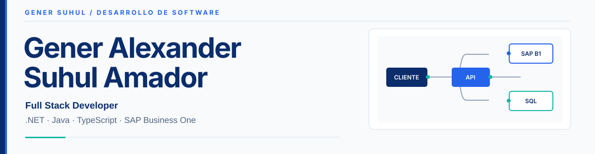

### [▶ EXPLORAR EL PORTAFOLIO WEB INTERACTIVO](https://gener-suhul-portfolio.vercel.app/)

*Animaciones propias en Canvas · Diagrama interactivo · Proyectos filtrables · Estudios técnicos*

[GitHub](https://github.com/GenerSuhul) · [Correo](mailto:gsuhula1@miumg.edu.gt)

---

# Gener Alexander Suhul Amador

**Desarrollador de software Full Stack | Backend .NET y Java | Integraciones empresariales**

Poptún, Petén, Guatemala · [Contacto](mailto:gsuhula1@miumg.edu.gt) · [Repositorios públicos](https://github.com/GenerSuhul?tab=repositories)

## Perfil profesional

Desarrollo aplicaciones web, servicios backend e integraciones para procesos empresariales. Desde octubre de 2024 trabajo en el área de IT de Agrisystems S.A., donde combino desarrollo de software con operación, soporte e integración de sistemas.

Mi experiencia se concentra en **C# / ASP.NET Core, TypeScript, Node.js, React, SQL y SAP Business One**. También he desarrollado proyectos con **Java, Spring Boot, Angular y Oracle**. Trabajo con bases de datos relacionales, APIs REST, autenticación, control de acceso, servicios de sincronización y herramientas de despliegue.

Me interesa especialmente el backend, el diseño de sistemas mantenibles y la conexión entre aplicaciones modernas y plataformas empresariales existentes.

## Experiencia profesional

**Agrisystems S.A. — Encargado de IT y desarrollo de software**  
*Octubre de 2024 – actualidad · Guatemala*

- Desarrollo y mantenimiento de aplicaciones para procesos comerciales, administrativos y operativos.
- Integraciones con **SAP Business One** mediante Service Layer, consultas SAP HANA y servicios intermedios en .NET.
- Diseño de APIs REST, procesos de sincronización y soluciones que conectan infraestructura local con servicios en la nube.
- Trabajo con **PostgreSQL, SQL Server y SAP HANA**, incluyendo consultas, validaciones, permisos y trazabilidad.
- Despliegue, diagnóstico de incidencias y soporte de aplicaciones en entornos Windows Server y Linux.

## Proyectos con código público

### [Bufete Popular UMG](https://github.com/GenerSuhul/buefete-umg)
**ASP.NET Core 10 · C# · React / Next.js · PostgreSQL · EF Core · Docker**

Plataforma para gestión jurídica y académica: expedientes, documentos digitalizados, roles, seguimiento de casos y auditoría. Arquitectura por capas y separación entre API, lógica de aplicación y persistencia.

### [Airport Platform — proyecto universitario](https://github.com/GenerSuhul/proyectoFinalSistemasOperativosII)
**Java 21 · Spring Boot 3 · Angular 19 · Oracle 23ai · Docker · Kubernetes**

Aplicación de reservas y gestión aeroportuaria con autenticación JWT, roles, panel administrativo y migraciones Flyway. Incluye manifiestos de Kubernetes, CI/CD con GitHub Actions y observabilidad con Prometheus y Grafana.

### [AeroPulse Live](https://github.com/GenerSuhul/aeropulse-live)
**Angular · TypeScript · APIs REST · Vercel**

Visualizador de tráfico aéreo con fuentes externas de datos, actualización de posiciones, manejo de límites de API y visualización interactiva en tiempo real.

## Proyectos empresariales

Algunos desarrollos tienen repositorios privados por su naturaleza operativa. Comparto aquí su alcance técnico sin publicar datos, credenciales ni procesos internos de terceros.

| Proyecto | Alcance técnico |
| --- | --- |
| **RENOVA Sales** | Aplicación web/PWA y Android para operación comercial en campo, con trabajo offline, cotizaciones y un puente privado de integración con SAP B1. **React, TypeScript, Supabase, .NET y SQL HANA.** |
| **Middleware SAP–Streamline** | Servicio de sincronización y API para planificación empresarial. Primera fase de consulta, sin escritura en SAP. **C#, .NET, Windows Service, Service Layer, PostgreSQL y Supabase Edge Functions.** |
| **AgriFlow** | Plataforma de logística para envíos, traslados, seguimiento y análisis de tiempos operativos. **React, TypeScript, PostgreSQL y Supabase.** |
| **Control de asistencia** | Integración de dispositivos Hikvision con gateway de eventos, almacenamiento y aplicación de consulta. **Node.js, TypeScript, React y PostgreSQL.** |

## Tecnologías

| Área | Herramientas y tecnologías |
| --- | --- |
| **Backend** | C#, .NET, ASP.NET Core, Java, Spring Boot, Node.js, Express, TypeScript, APIs REST, JWT |
| **Frontend** | React, Next.js, Angular, JavaScript, HTML, CSS, Vite |
| **Datos e integración** | PostgreSQL, SQL Server, Oracle Database, SAP HANA SQL, SAP Business One Service Layer, Supabase |
| **Infraestructura y entrega** | Docker, Kubernetes, Linux, Windows Server, Nginx, Git, GitHub Actions, CI/CD, Prometheus, Grafana |
| **AWS** | Diseño y configuración de redes VPC y subredes; evaluación de infraestructura EC2, ECS y EBS |
| **Herramientas de desarrollo** | Visual Studio Code, Visual Studio, GitHub, OpenAI Codex CLI para asistencia en código, pruebas y revisión técnica |

## Formación y reconocimientos

- **Ingeniería en Sistemas de Información y Ciencias de la Computación**, Universidad Mariano Gálvez de Guatemala. **Séptimo semestre en curso.**
- **Primer lugar en Programación**, competencias de Ingeniería en Sistemas, octubre de 2026.
- **Segundo lugar en Exhibición de Proyectos**, competencias de Ingeniería en Sistemas, octubre de 2026.

---

**Contacto:** [gsuhula1@miumg.edu.gt](mailto:gsuhula1@miumg.edu.gt) · [GitHub](https://github.com/GenerSuhul)

*Los repositorios públicos muestran una parte de mi trabajo. Los proyectos empresariales se describen a nivel funcional y técnico para respetar su confidencialidad.*
